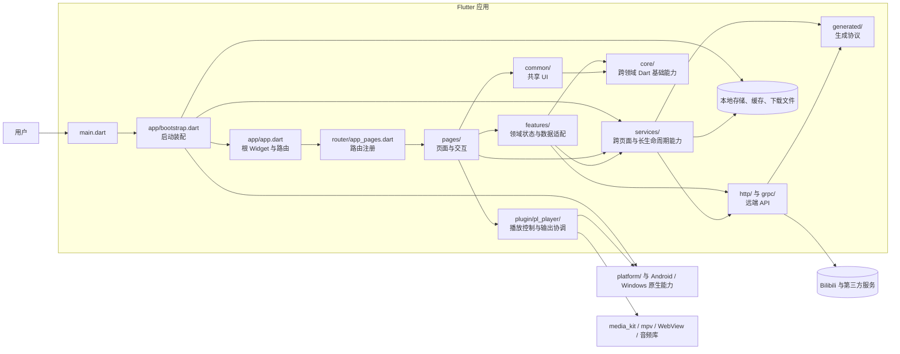
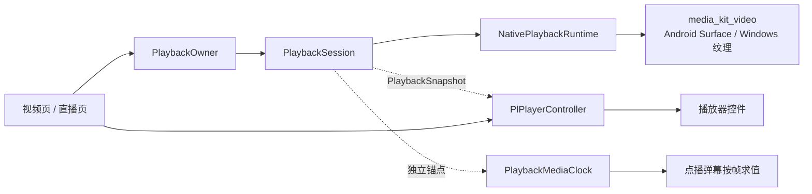

# 架构概览

播放器、弹幕显示和帧调度的分层图与交互时序见[详细架构图](../diagrams/README.md)。

应用由 Flutter 客户端、平台插件、远端服务和本地数据组成。图中箭头表示常见调用方向。

## 系统边界

应用没有配套服务端。网络访问、平台插件和本地文件系统都是应用边界；Android 与 Windows 共用大部分 Dart 页面和服务，但窗口、WebView、媒体输出和解码路径有平台差异。

## 目录职责

| 目录 | 主要职责 | 修改时先看 |
| --- | --- | --- |
| `lib/app/` | 启动装配、路径准备、平台初始化、根 Widget 与返回导航 | `bootstrap.dart`、`platform_setup.dart`、`app.dart` |
| `lib/router/` | 路由注册、深链接解析与页面跳转 | `app_pages.dart`、`app_scheme.dart`、`page_utils.dart` |
| `lib/features/` | 领域模型、数据适配、应用状态与展示 | [功能地图](features.md)及各领域 README |
| `lib/pages/` | 按用户功能组织 view、controller 和局部组件 | 路由、controller、对应测试 |
| `lib/http/` | 业务 API 与请求层横切逻辑 | API 调用方、响应模型、`init.dart` |
| `lib/services/` | 消息、设置与存储、直播流、缓存和诊断等跨页面能力 | 所属模块的状态与数据接口 |
| `lib/grpc/` | gRPC 请求与传输适配 | 功能层调用方与协议转换 |
| `lib/generated/bilibili/` | Bilibili protobuf 生成快照 | [协议产物更新约定](../../lib/generated/README.md) |
| `lib/plugin/pl_player/` | 播放状态、媒体源、弹幕、原生输出和全屏控制 | `controller.dart`、对应平台实现和测试 |
| `lib/common/` | 共享控件、布局、样式与交互反馈 | 控件调用方及其测试 |
| `lib/core/` | Dart 集合、解析、时间、文件与调度基础能力 | 纯 Dart 接口，禁止依赖应用层和 Flutter |
| `lib/platform/` | 平台能力、桌面窗口和 Android JNI 桥接 | 对应平台实现与主机测试 |
| `android/`、`windows/`、`third_party/` | 平台工程、插件和本地维护的依赖实现 | 依赖登记、生成脚本和平台构建配置 |

展示层经由功能入口或服务发起请求。业务类型归所属模块，`domain/` 保存页面可消费的领域数据和规则，`data/` 保存传输适配、持久化与协议转换。`features/media_catalog/domain/` 定义跨搜索、发现、空间与播放共享的视频和作者摘要。其余选源、音轨和直播房间模型归播放模块。

Riverpod 由根 ProviderScope 装配，页面查询和应用级服务按各自生命周期管理。各功能的状态所有者、账号切换和异步失效约定见[状态管理](state-management.md)。

新增业务状态使用 Riverpod，GetX 保留路由及存量适配。页面通过功能的应用层读取状态和提交意图；传输、全局存储和跨领域业务工具由数据层或明确的服务所有者访问。

[全库依赖检查](../../test/architecture/legacy_dependencies_test.dart)拒绝 GetX 业务类型、展示层直接访问传输或存储，以及在设置区之外直接读取完整设置目录。展示层通过所属模块的配置接口读写偏好；设置区可读取类型化设置目录，但不直接访问存储。`LoadingState` 仍是共享结果类型，生成文件不纳入业务源码检查。

## 桌面窗口与标题栏

Windows 主窗口和独立播放窗口在窗口初始化时将 Skia raster 资源缓存预算设为 64 MiB，以约束绘制目标和可回收 scratch 的高水位；设置失败时继续使用引擎预算。这不限制 IO 图片纹理、视频输出或进程总内存。图片缓存继续由框架 binding 单独管理；不在退出播放时强制清理图形设备或运行 GC。

Windows 定制引擎的 ANGLE 对实际 AMD D3D11 适配器默认使用 `Image11` staging 图片上传，降低浏览后的上传内存保留；其他厂商沿用上游策略。策略在引擎初始化时生效，主窗口和独立播放窗口共用，图片质量和解码规则保持独立。它只影响引擎内 ANGLE，播放器独立 ANGLE 沿用其配置；构建材料、设备验证范围及临时回退见[引擎说明](../../tool/engine/windows_frame_pacing/README.md)。

`lib/app/platform_setup.dart` 隐藏系统标题栏和系统窗口按钮。主窗口由 `app.dart` 在路由外装配 `DesktopWindowFrame`（`desktop_title_bar.dart`），启动失败页复用同一组件；独立播放窗口继续使用播放器自己的窗口控件。

`DesktopTitleBar` 随 Flutter 主题和应用图标设置更新，提供拖动、双击最大化、最小化、最大化/还原和关闭入口。关闭按钮调用普通窗口关闭事件，沿用主窗口已有的托盘驻留与播放器释放流程。最大化状态由窗口事件更新，初始化查询通过修订号隔离迟到结果，组件释放时移除监听。

`DesktopWindowFrame` 的 Overlay 覆盖整个窗口，标题栏与页面作为同一基础内容绘制，按钮提示显示在页面上方。不要把 Overlay 缩到标题栏高度：即便关闭裁剪，越界提示仍可能被随后绘制的页面遮挡。页面的 `MediaQuery.size` 使用扣除标题栏后的实际内容尺寸。

标题栏订阅 `DesktopWindowBackground.fullscreen`，全屏时隐藏、退出后恢复，页面子树状态保留。“显示窗口标题栏”的生效时机见[设置行为](settings-behavior.md#桌面窗口)。回归入口为 `test/app/desktop_title_bar_test.dart`，包含提示像素检查、主题、窗口事件和全屏状态保留；测试边界见[测试目录](../../test/README.md)。

## 播放统一架构

状态变量、不变量、反例构造和验证边界见[播放器状态模型](playback-model.md)。

点播视频和直播共用一套播放协议。页面只拥有业务计划和页面副作用；播放状态、原生操作与输出资源分别由 owner、会话和运行时持有。

| 层 | 主要入口 | 职责 | 不应承担 |
| --- | --- | --- | --- |
| 页面 | `pages/video/`、`pages/live_room/` | 生成业务内容键，解析地址和媒体候选，装配 `PlaybackPlan`，处理字幕、历史和弹幕等页面副作用 | 直接调度原生加载、把 URL 当作内容身份 |
| 页面所有者 | `PlaybackOwner` | 表达页面控制权，提交查询、加载和控制命令，持有页面 inhibitor 与 keepalive 租约 | 跨页面保存原生资源 |
| 播放会话 | `PlaybackSession` | 接受请求代次，提交不可变计划，合并播放意图与配置，执行来源故障切换和命令串行化，发布状态快照与独立媒体锚点 | 构建控件、发起业务 HTTP 请求 |
| 原生运行时 | `NativePlaybackRuntime` | 创建和释放 Player/VideoController，校验原生事件身份，准备输出、首帧和几何，采样媒体时钟，串行执行已接受的原生操作 | 判断页面业务归属 |
| UI 门面 | `PlPlayerController` | 把快照投影到现有控件状态，转发页面命令，保留播放器外观与业务适配 | 成为播放状态或原生输出的第二所有者 |
| 平台输出 | `media_kit_video` 及 `third_party/` 适配 | 管理 Surface/纹理、输出代次、尺寸提交、帧交接和释放回执 | 推断视频业务身份 |

`PLVideoPlayer` 按图层装配展示，控制菜单、输入、弹幕操作、输出交接和动态截图分别管理自己的展示资源。输入与输出协调器通过参数接收依赖，子模块各自成库；修改入口、交互语义和释放顺序见[播放器展示模块](../../lib/plugin/pl_player/view/README.md)。

关键约束：

- `PlaybackPlan` 冻结业务内容键、来源候选索引、时间线、位置和已捕获配置。内容键表示视频、分集或直播间，来源地址只表示当前候选。
- 查询绑定 requestId 与 owner；加载和命令继续绑定 loadId。失去控制权的 owner 不能提交新操作；已发出的原生操作可以完成，但返回值只有代次仍匹配时才进入规范状态。
- `PlaybackSnapshot` 区分用户意图、原生实际状态和 inhibitor。命令成功表示原生写入被接受，实际播放、暂停和缓冲状态由原生观测事件更新。
- 原生事件、输出挂载和释放回执都必须匹配当前 runtimeId、loadId 与 outputEpoch。迟到的结果不能覆盖新加载或新输出。
- 页面关闭先停止接受命令，再排空已接受操作、卸载媒体、释放输出并销毁 Player。跨控制器运行时槽等待 `Player.released` 后才允许下一次初始化。
- Windows 独立播放窗口拥有自己的 Flutter 进程、Player、输出和缓存；主窗口只负责启动、排列、声音切换、设置快照和离线进度回写。

`test/plugin/pl_player/playback/` 下，`playback_session_test.dart` 检查请求代次、播放意图、配置和故障切换。媒体锚点和弹幕交接见 `session_media_clock_test.dart`，命令时限、控制权和资源释放见 `player_architecture_acceptance_test.dart`。

在设备上用 [`session_device_acceptance.dart`](../../tool/probes/playback/session_device_acceptance.dart)、[`paused_output_attach.dart`](../../tool/probes/playback/paused_output_attach.dart) 和 [`session_paused_load.dart`](../../tool/probes/playback/session_paused_load.dart) 验证加载、暂停、首帧和释放。

## 关键边界与约束

- `main.dart` 只进入 `bootstrapApplication()`。启动依赖顺序和服务装配集中在 `app/bootstrap.dart`；平台初始化在 `app/platform_setup.dart`。
- `app_pages.dart` 是路由注册表。新增或移动页面时同步检查路由名、构造参数、返回栈和 deep link 调用方。
- `services/` 负责跨页面共享或需显式管理生命周期的工作。页面状态由所属页面或领域模块持有。
- `services/messaging/` 按主账号的 `MessagingSession` 管理消息业务。GetX 保留路由，Riverpod 订阅业务快照；聊天和分享共用会话缓存及发送锁。分类消息句柄由页面 Notifier 创建和释放，未读概览、会话列表及聊天缓存由 Session 持有。入口和异步约定见[消息模块](../../lib/services/messaging/README.md)。
- `DownloadRepository` 负责下载目录布局和记录读写；`DownloadService` 负责队列、状态和任务调度；`DownloadManager` 负责单路媒体传输。详情见[下载流程](runtime-flows.md#下载)。
- `DownloadRepository` 写入前编码快照，同目录临时文件 flush/close 后重命名替换，并保留上次可读 JSON 的 `.bak`。启动按正式文件、备份、临时文件顺序恢复记录与媒体索引，读取或恢复失败通过回调报告；Windows 文件占用时不删除正式文件重试。替换以单文件为单位；断电恢复时核对目录项和媒体文件，进程中断后的续传进度以实际媒体文件长度为准。
- 播放各层职责与代次见上方[播放统一架构](#播放统一架构)。偏好在装配计划或运行时配置时读取；字幕、历史和弹幕等页面副作用提交时核对媒体及页面归属。
- 显式后台媒体租约可让页面 owner 关闭后继续播放；最后一个 owner 和租约释放后才关闭会话。路由、后台与音频焦点分别释放自己的 inhibitor，保留用户暂停意图。
- 快速切源复用 Player、控制器、订阅和纹理。过期操作在进入原生前跳过，已发出的操作仍沿运行时串行链完成并核对代次。
- Windows 子窗口通过本地连接接收播放、账号及设置快照，设置仅在内存生效；超分重建先卸载媒体，再重建输出并重载，恢复点播位置与最新意图。资源释放顺序见[Windows 视频输出](../maintenance/windows-video-output.md)。
- protobuf 与 Android JNI 属于生成产物，不直接手改。JNI 从项目源定义和脚本更新；Bilibili protobuf 的快照与生成前置条件见[协议产物](../../lib/generated/README.md)。
- 定制依赖通过 `dependency_overrides` 指向 `third_party/` 中的本地包。来源、版本和许可证以 `pubspec.yaml`、`pubspec.lock` 与 [`third_party/README.md`](../../third_party/README.md) 为准。

`test/architecture/dependency_rules_test.dart` 断言 `main.dart` 不被导入、`app/` 不被底层模块依赖；也检查下载仓库不依赖 UI、GetX、网络或全局存储，以及下载执行器通过构造参数接收 Dio。

`test/architecture/legacy_dependencies_test.dart` 拒绝新增 GetX 业务继承、展示层直连传输和全局存储，以及对生成协议和定制包内部实现的直接依赖。迁移清除对应的存量清单项，CI 分析整个 `lib test tool`，生成快照与定制包不混入应用分析范围。

新增模型和工具放在负责该业务规则的模块。`core/` 只接收不含业务规则的 Dart 基础代码，平台实现进入 `platform/`，展示适配与组件放在功能展示层或 `common/`。依赖测试防止恢复 `lib/utils/`、`lib/models/`，并检查 `core/` 的依赖方向。业务源码、生成协议和定制包的搜索入口见[协议产物](../../lib/generated/README.md)。

## 状态与本地数据

| 数据 | 所有者/入口 | 说明 |
| --- | --- | --- |
| 设置与本地 box | `GStorage`、`Pref`、`SettingBoxKey` | 存储初始化在启动阶段完成；新增设置时同步默认值和键定义。 |
| 下载记录与媒体索引 | `DownloadRepository` | 文件位于下载根目录；目录格式与 JSON 字段由仓库维护。 |
| 临时目录、缓存、字体 | `app/app_paths.dart`、`CacheManager`、`FontUtils` | 初始化先于页面使用。 |
| 诊断记录 | `services/diagnostics/`、`DiagnosticReportHandler` | 记录会按设置脱敏；导出前仍应确认没有账号凭据。 |
| 播放器状态 | `PlaybackSession`、`PlaybackOwner`、`NativePlaybackRuntime` 与 `PlPlayerController` | 会话快照是规范状态；owner 表达页面控制权，运行时拥有原生资源，控制器负责 UI 投影和业务适配。 |
| 消息状态 | `MessagingSession`、业务句柄与 Riverpod provider | 根 Widget 提供 `ProviderScope`；切换主账号时释放旧 Session，订阅重建。消息列表、聊天缓存和未读快照保存在内存中。 |

## 图片加载与交互预览

图片模块统一管理来源快照、解码准入和内容需求；`ContentViewer` 将手势变成稳定源坐标的视口，`ContentImage` 持有显示会话。Windows Gallery 的静态 JPEG/PNG/WebP 使用随包 CPU worker，经有界管道交付普通 `ui.Image`；来源租约等待 worker 真实退出。普通正文、动画与其他平台保留完整帧路径。预算、能力回退和验证边界见[图片模块](../../lib/common/widgets/image/README.md)。

## 弹幕显示与来源

`NativePlaybackRuntime` 持有只读 `PlaybackFrameSource`，按输出 token、平台采样代次、阶段和批次序号隔离高频视频采样。Android 请求采样经监听注册与新 buffer 关联确认；纹理消费继续独立用于首帧和播放健康。暂停、缓冲、seek 和输出重配关闭相位准入，恢复条件成立且取得新帧确认后开启新代次。

点播、直播各持有一份 `DanmakuFrameScheduler`，集中管理所属视图、视频采样订阅、连续更新与一次性刷新。显示值变化清除旧相位和待匹配帧；同一 Flutter 帧合并一次更新。位置使用帧目标时间，候选年龄和期限使用回调开始的单调时间。启动装配的呈现配置与自编引擎身份对应，构建入口见[引擎协议](../../tool/engine/README.md)。

点播显示通过 `PlaybackMediaClock` 读取不可变的 `PlaybackMediaAnchor`，独立于低频播放快照。锚点包含媒体位置、进程单调时间、实际速率、推进状态、连续性标识和有效期；外推到有效期末端后停止。原生属性由 `native_media_clock_worker.dart` 在后台 isolate 读取，`NativeMediaClockSampling` 合并在途通知；运行时在发布前核对 Player、加载绑定、seek 序号和连续性，释放 Player 前等待读取退出。暂停、缓冲和倍速变化对应的锚点更新与 seek 确认流程见[运行流程](runtime-flows.md#媒体时钟与跳转确认)。

`PlDanmaku`装配业务范围来源、只读媒体时钟和显示配置；`LiveDanmaku`装配房间规范消息和运行状态。显示实现共用`DanmakuWindowRenderer`，普通轨迹、跨轨准入、数量和命中规则来自`canvas_danmaku`的共享几何。绘制读取生效工作集，更新阶段管理位置、到期、选择及图片引用。

点播来源和显示按100ms桶选取候选：自己发送的弹幕优先，其余按相对权重降序，同权重保持来源次序。合并代表项继承组内最高权重；跨worker批次收到权重提升后，此前淘汰的代表项可以重新进入来源缓存，仍按原始次序处理同权重竞争。

高权重候选优先分配轨道，已建立的轨迹与选择保持稳定。有界前瞻允许先编排部分候选，完整准备前沿仍等待剩余候选。窗口回收已经结束的历史结果并保留存活轨迹；预算见[默认构建与策略](build-defaults.md)，对照方法见[密度实验](../../tool/experiments/README.md#配置选择)。

直播候选保留传输入口的单调收到时间，运动时间累计显示运行时段；候选年龄与资源期限在暂停期间继续推进。隐藏解除直播显示订阅，聊天和SC由房间继续消费。

页面通过`DanmakuDisplayBinding`和只读交互快照进行选择、列表、清屏和来源回显。点播缓存只向显示模块交付不可变的 `DanmakuTimelineEntry`，不传递生成协议对象；在线条目在范围读取时转换为微秒，本地发送保留实际投放的微秒位置。轨道、活动项和图片保留在显示实例。来源替换、seek和卸载结束旧选择；局部来源失效按条目原始时间撤回受影响项，保留无关活动轨迹、图片与选择。显示配置按小批次准备，轨迹、资源和命中在同一帧生效。点播范围来源的过滤/合并更新先通知失效，再提交最新规则结果。

来源解码和合并共用进程级`DanmakuWorkQuota`，运行任务实际退出后归还额度。解析前检查单条编码与字段数量，后续处理沿同一预留核对批次、合并上下文、规则和结果占用；原始缓存与处理结果缓存分别限制字节。数量、字节或桶满额时通过有界优先索引替换较低权重项。文件来源保留有界候选供范围读取，显示层按自身预算再次选择。范围覆盖区分未加载、加载中、失败、失效及已加载。

在线分段和本地文件由 `features/danmaku/data/` 解码，在处理租约内转成 `DanmakuElement` 交给点播来源。下载导出使用原始回复。本地文件通过外部稳定排序和持续合并游标处理，排序保留原始元素字节和未知字段，内存缓存保留当前所需分段。排序产物由来源持有，范围与规则变化复用它。原文件路径、长度或文件时间变化时重建，来源释放等待当前读取退出后清理。显示实例持有表情源图引用，源图、栅格、候选及在途图片预留共用实例工作集，图片按共享 backing 计账。

## 平台边界

| 平台 | 主要代码 | 需单独确认的行为 |
| --- | --- | --- |
| Android | `android/`、JNI helper、`pl_player/utils/android_*` | MediaCodec、Surface 生命周期、旋转、系统栏和音频输出 |
| Windows | `windows/`、窗口管理、Windows WebView 与媒体输出代码 | 窗口尺寸/DPI、WebView 环境、GPU 解码、纹理尺寸和弹幕渲染 |

工具链和平台构建要求见[构建与测试](build-and-test.md)；运行时调用时序见[运行流程图](runtime-flows.md)。

## 凭证存储与备份

`CredentialCipher` 复用现有 `encrypt` 依赖，以 AES-GCM 和随机 nonce 加密账号 Cookie、Token 与 WebDAV 密码。本机 Hive 和 JSON 备份共用版本化密文格式，普通设置保持原格式。

启动时读取并迁移旧明文凭证，重写后压缩 Hive 文件。备份导入兼容旧明文；损坏或未知版本的密文会报错。新密文需要支持该格式的应用版本读取，维护密钥或格式时须保留旧版本解密路径。

## 领域术语

| 术语 | 项目含义 |
| --- | --- |
| 上游 | PiliPlus 2.1.5 及其历史来源，更新不会自动同步 |
| 移动端/桌面端 | 当前发布目标为 Android/Windows x64；`PlatformUtils.isMobile` 可能代表平台集合 |
| mid | Bilibili 用户标识 |
| aid/bvid | 视频标识，接口所需字段可能不同 |
| CID | 分 P 或媒体内容标识，播放地址及视频弹幕常用 |
| UGC/PGC | 用户生成内容/专业或版权内容，分集与播放流程有差异 |
| 内容键 | `PlaybackPlan.contentKey`，标识视频、分集或直播间，区别于来源 URL |
| 输出代次 | `outputEpoch`，关联输出准备、挂载、几何与释放回执 |
| inhibitor | 阻止自动恢复或继续播放的外部令牌，例如音频焦点、后台策略与输出不可用 |

排障时区分地址、网络、解码和渲染阶段；图片、HTTP、播放器和下载缓存分别计量。本地账号记录、当前账号、凭据有效性与服务端会话也须分别核对。
